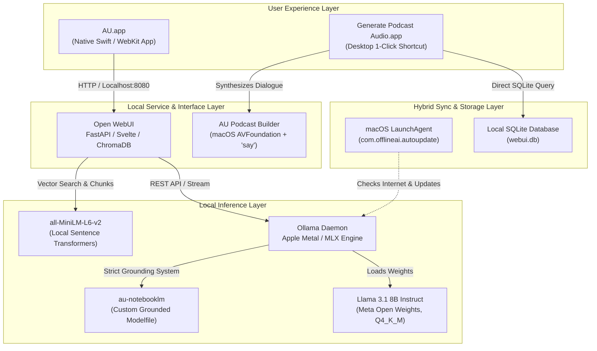

# 🤖 AU — Private Offline AI System for macOS

[](https://www.apple.com)
[](https://www.apple.com/macos/)
[](https://ollama.com)
[](https://ai.meta.com/llama/)
[]()
[](LICENSE)

> **AU** is an entirely private, air-gapped, offline Artificial Intelligence workstation engineered natively for Apple Silicon Macs. It bundles local LLM inference, native document ingestion (RAG), Google NotebookLM research capabilities, and an offline multi-host audio podcast synthesizer into a standalone native macOS Cocoa application.

---

## 🌟 Key Features

- **100% Offline & Private:** Zero telemetry, no cloud API keys, and no data leaves your Mac.
- **Native macOS Application (`AU.app`):** Built with Swift 6.2 and WebKit. No browser tabs or terminal commands needed for daily use.
- **Apple Silicon Acceleration:** Powered by Ollama using Apple Metal and MLX for maximum tokens/second on M-series chips (M1/M2/M3/M4).
- **Interactive Assistant HUD Console:** Live real-time colored state badges:
  - `🟢 LISTENING (Your Turn)`
  - `🟡 HEARING (Recording Audio)`
  - `🟣 THINKING (M4 Brain)`
  - `⚡ EXECUTING (Mac Automation)`
  - `🗣️ SPEAKING (Voice Synthesis)`
- **Persona Studio (LibreChat-Inspired):** Dynamically switch between 4 specialized AI agents from the toolbar:
  - `⚡ Mac Automator`: Spotify, volume, Finder, screenshots, system controls
  - `🧠 Research Partner`: Grounded document RAG, citations, and summaries (`au-notebooklm`)
  - `🎙️ Podcast Studio`: Multi-speaker dialogue synthesis & two-host audio generation
  - `💻 Code Architect`: Bash execution, Python scripting, and technical debugging
- **LibreChat-Style Artifacts Drawer:** Slide-over native side pane for viewing, browsing, and opening notes, reports, and code artifacts generated by AU in `~/Documents/AU_Notes`.
- **RAGFlow Layout-Aware Document & Table Parser (`au_document_parser.py`):** Converts CSV/delimited files into clean Markdown tables and chunks documents hierarchically by headings (`#`, `##`, `###`) without cutting tables or code blocks midway.
- **Dify-Inspired Hybrid RRF Search:** Combines SQLite FTS5 BM25 keyword rankings with semantic token-overlap and recency scores using Reciprocal Rank Fusion (RRF) for pin-point retrieval accuracy.
- **Offline Web Research & Article Scraper (`au_tools.py`):** Native tools `browse_url` and `search_web_summary` that query DuckDuckGo and fetch clean, ad-free article text for the agent without opening browser tabs.
- **Khoj-Style Local Notes Watcher (`tools/au-watcher`):** Background daemon that automatically monitors `~/Documents/AU_Notes` and indexes new notes into Mem0 memory.
- **Jan-Inspired Apple Silicon Hardware Telemetry HUD:** Real-time RAM and unified memory pressure gauge in `AU.app` toolbar (`RAM: 4.1 / 16.0 GB 🟢 M4 Optimal`).
- **Mem0 Offline Personal Memory Engine (`tools/au-memory`):** SQLite + FTS5 full-text search engine that remembers user preferences, habits, and explicit notes across sessions without any cloud service.
- **OpenHands Multi-Step Action/Observation Loop:** Autonomous multi-turn problem solving (up to 5 steps). AU plans, executes an action, inspects the factual observation, and reflects before speaking.
- **Model Context Protocol (MCP) & Type-Safe Tools (`au_tools.py`):** 18 registered Pydantic v2 validated system tools for volume, apps, Spotify, web search, scraping, screenshots, file I/O, notes, and bash execution.
- **Multimodal Vision & 1-Click Transcript Export:** Local image inspection dialog (`llama3.2-vision` / `llava`) and 1-click Markdown transcript exporter in `AU.app` menu.
- **Instant Offline Voice Cloner (`tools/au-clone-voice`):** Isolated 10-second reference voice cloning running entirely on Apple Silicon MLX (F5-TTS) with instant fallback to native macOS voices (Samantha & Daniel).
- **NotebookLM Research Engine (`au-notebooklm`):**
  - **Strict Source Grounding:** Constrained to answer only from your uploaded documents without hallucination.
  - **Inline Citations:** Automatic references linking back to your source pages and sections.
  - **Knowledge Synthesis:** Instant Study Guides, Practice Quizzes, Executive Briefings, FAQs, and Timelines.
- **Offline Audio Podcast ("Deep Dive"):** Converts notes and research into an actual 2-host audio podcast (`.m4a`) using native macOS speech synthesis (Samantha & Daniel) and AVFoundation audio stitching.
- **Hybrid Auto-Sync:** Works completely offline without internet, but automatically checks for model and software updates every 6 hours whenever connected to Wi-Fi.

---

## 🏗️ System Architecture



---

## 📁 Repository Structure

```
.
├── build.sh                     # Compiles the Swift app and podcast builder
├── scripts/
│   ├── setup.sh                 # One-click installation script
│   ├── start-AU.sh              # Terminal launcher and daemon watchdog
│   ├── make-podcast.sh          # Auto-extracts chat script and builds audio
│   └── auto-update-models.sh    # Background internet updater
├── src/
│   ├── app/
│   │   ├── main.swift           # Native macOS Cocoa + WebKit application code
│   │   ├── generate_icon.swift  # CoreGraphics high-res app icon generator
│   │   └── Info.plist           # macOS bundle metadata & permissions
│   ├── models/
│   │   └── Modelfile.notebooklm # Custom Ollama prompt & inference parameters
│   └── podcast_builder/
│       └── main.swift           # AVFoundation multi-track audio stitcher
├── launchd/
│   └── com.offlineai.autoupdate.plist # macOS LaunchAgent configuration
├── docs/
│   ├── OFFLINE_AI_GUIDE.md      # User guide & operations manual
│   └── PROJECT_REPORT.md        # Technical architecture report
└── README.md
```

---

## 🚀 Quickstart

### Prerequisites
- macOS 13.0+ (Sonoma, Sequoia, Tahoe or later recommended)
- Apple Silicon Mac (M1/M2/M3/M4) with 16 GB RAM recommended
- [Homebrew](https://brew.sh) installed

### 1. Clone the Repository
```bash
git clone https://github.com/govenderaditya-coder/au-offline-ai.git
cd au-offline-ai
```

### 2. Run Setup
```bash
bash scripts/setup.sh
```

### 3. Build Native Binaries
```bash
bash build.sh
```

### 4. Launch AU
Double-click `AU.app` or move it to your Applications folder:
```bash
cp -R AU.app /Applications/
open /Applications/AU.app
```

---

## 🎙️ Creating Offline Audio Podcasts

1. In the **AU** app, upload your documents and prompt:
   > *"Generate a podcast dialogue between Samantha and Daniel summarizing these notes."*
2. Run the podcast synthesizer (or double-click `Generate Podcast Audio`):
   ```bash
   bash scripts/make-podcast.sh
   ```
3. QuickTime will open automatically with your generated `.m4a` audio podcast!

---

## 🧠 Managing Personal Memory (Mem0)

AU continuously learns your preferences completely offline into `~/.offline-ai/memory.db`.
Use the included CLI to inspect and manage your memories anytime:

```bash
# List all stored personal memories
./tools/au-memory list

# Search memories via SQLite FTS5 full-text search
./tools/au-memory search "python"

# Manually add a memory
./tools/au-memory add "User prefers dark mode and local models" preference

# Remove a specific memory
./tools/au-memory delete 1

# Wipe all stored memories
./tools/au-memory clear
```

---

## 🎙️ Cloning Your Voice (Apple Silicon MLX)

AU includes an instant offline voice cloner running on Apple MLX Neural Engine:

```bash
# Record 10 seconds of speech to clone your voice
./tools/au-clone-voice

# Test voice synthesis
./tools/au-speak "Hello! This is my cloned voice speaking through AU."
```

In `AU.app`, toggle between `👩 Female (Samantha)`, `👨 Male (Daniel)`, and `🎙️ Cloned (MLX)`.

---

## 💻 AU Terminal CLI & Autonomous Code Architect

AU includes a native Unix pipeline CLI (`tools/au`) inspired by Gemini-CLI and Aider:

```bash
# Pipe any file or command output directly into AU
cat file.py | ./tools/au "explain what this code does"
git diff | ./tools/au "generate a conventional git commit message"

# Autonomous coding mode with compact AST Repo Map (<1000 tokens)
./tools/au --code "add boundary check to au_tools.py"

# Auto-commit modified files when task succeeds
./tools/au --code --commit "fixed edge case in file editor"

# Voice response flag
./tools/au --voice "what is my battery level?"
```

---

## 📄 License

This project is licensed under the MIT License — see the [LICENSE](LICENSE) file for details.
