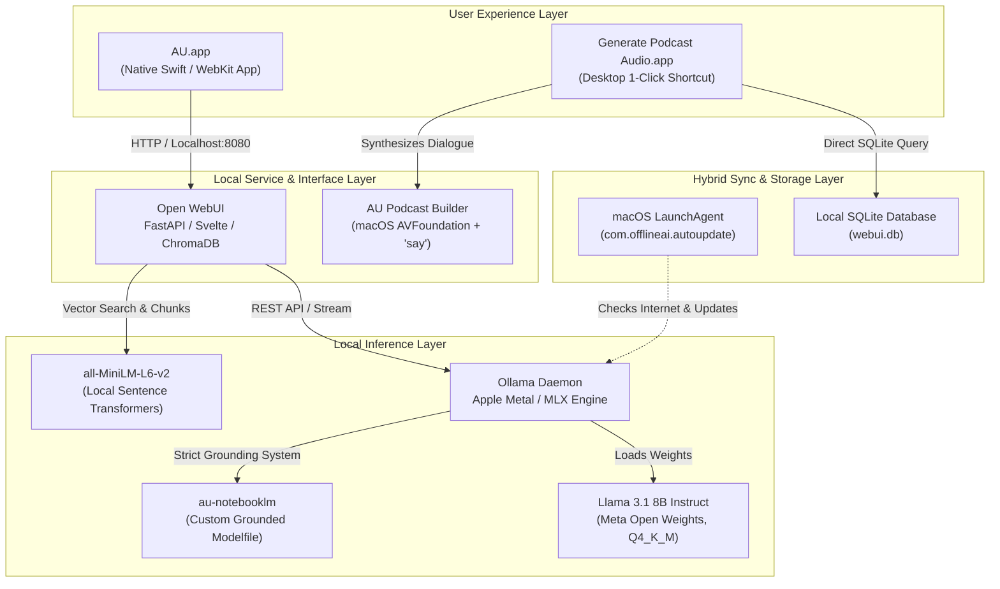

# 🤖 AU — Private Offline AI System for macOS

[](https://www.apple.com)
[](https://www.apple.com/macos/)
[](https://ollama.com)
[](https://ai.meta.com/llama/)
[]()
[](LICENSE)

> **AU** is an entirely private, air-gapped, offline Artificial Intelligence workstation engineered natively for Apple Silicon Macs. It bundles local LLM inference, native document ingestion (RAG), Google NotebookLM research capabilities, and an offline multi-host audio podcast synthesizer into a standalone native macOS Cocoa application.

---

## 🌟 Key Features

- **100% Offline & Private:** Zero telemetry, no cloud API keys, and no data leaves your Mac.
- **Native macOS Application (`AU.app`):** Built with Swift and WebKit. No browser tabs or terminal commands needed for daily use.
- **Apple Silicon Acceleration:** Powered by Ollama using Apple Metal and MLX for maximum tokens/second on M-series chips.
- **NotebookLM Research Engine (`au-notebooklm`):**
  - **Strict Source Grounding:** Constrained to answer only from your uploaded documents without hallucination.
  - **Inline Citations:** Automatic references linking back to your source pages and sections.
  - **Knowledge Synthesis:** Instant Study Guides, Practice Quizzes, Executive Briefings, FAQs, and Timelines.
- **Offline Audio Podcast ("Deep Dive"):** Converts notes and research into an actual 2-host audio podcast (`.m4a`) using native macOS speech synthesis (Samantha & Daniel) and AVFoundation audio stitching.
- **Hybrid Auto-Sync:** Works completely offline without internet, but automatically checks for model and software updates every 6 hours whenever connected to Wi-Fi.

---

## 🏗️ System Architecture



---

## 📁 Repository Structure

```
.
├── build.sh                     # Compiles the Swift app and podcast builder
├── scripts/
│   ├── setup.sh                 # One-click installation script
│   ├── start-AU.sh              # Terminal launcher and daemon watchdog
│   ├── make-podcast.sh          # Auto-extracts chat script and builds audio
│   └── auto-update-models.sh    # Background internet updater
├── src/
│   ├── app/
│   │   ├── main.swift           # Native macOS Cocoa + WebKit application code
│   │   ├── generate_icon.swift  # CoreGraphics high-res app icon generator
│   │   └── Info.plist           # macOS bundle metadata & permissions
│   ├── models/
│   │   └── Modelfile.notebooklm # Custom Ollama prompt & inference parameters
│   └── podcast_builder/
│       └── main.swift           # AVFoundation multi-track audio stitcher
├── launchd/
│   └── com.offlineai.autoupdate.plist # macOS LaunchAgent configuration
├── docs/
│   ├── OFFLINE_AI_GUIDE.md      # User guide & operations manual
│   └── PROJECT_REPORT.md        # Technical architecture report
└── README.md
```

---

## 🚀 Quickstart

### Prerequisites
- macOS 13.0+ (Sonoma, Sequoia, Tahoe or later recommended)
- Apple Silicon Mac (M1/M2/M3/M4) with 16 GB RAM recommended
- [Homebrew](https://brew.sh) installed

### 1. Clone the Repository
```bash
git clone https://github.com/YOUR_USERNAME/au-offline-ai.git
cd au-offline-ai
```

### 2. Run Setup
```bash
bash scripts/setup.sh
```

### 3. Build Native Binaries
```bash
bash build.sh
```

### 4. Launch AU
Double-click `AU.app` or move it to your Applications folder:
```bash
cp -R AU.app /Applications/
open /Applications/AU.app
```

---

## 🎙️ Creating Offline Audio Podcasts

1. In the **AU** app, upload your documents and prompt:
   > *"Generate a podcast dialogue between Samantha and Daniel summarizing these notes."*
2. Run the podcast synthesizer (or double-click `Generate Podcast Audio`):
   ```bash
   bash scripts/make-podcast.sh
   ```
3. QuickTime will open automatically with your generated `.m4a` audio podcast!

---

## 📄 License

This project is licensed under the MIT License — see the [LICENSE](LICENSE) file for details.
