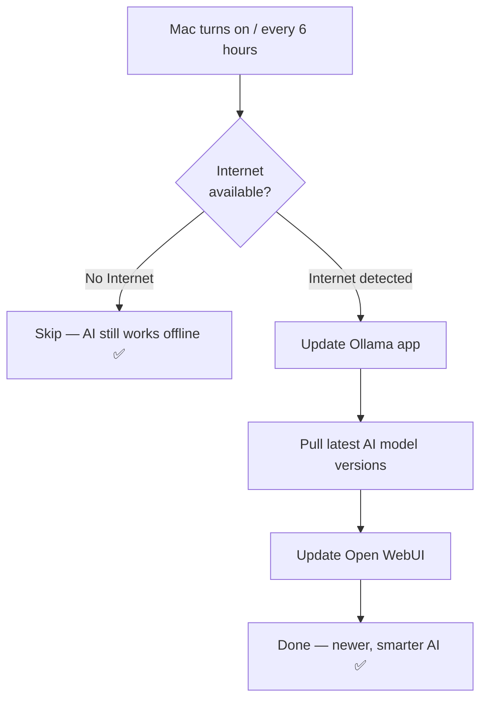

# 🤖 Your Offline AI — Complete Setup Guide

> [!IMPORTANT]
> Your Mac specs: **MacBook Air · Apple M4 · 16 GB RAM · 228 GB disk (only 2.7 GB free!)**
> ⚠️ You need to **free up at least 10 GB** before running setup — delete unused apps/files first.

---

## 🏆 Your Stack (Best for M4 Mac)

| Layer | Tool | Why This One |
|---|---|---|
| **AI Engine** | **Ollama** | Native Apple Silicon support, fastest on M4 |
| **Chat GUI** | **Open WebUI** | ChatGPT-like UI, supports documents, free |
| **Auto-Update** | **Custom Script + LaunchAgent** | Updates models silently when online |

---

## ⚠️ Free Up Disk Space First!

You currently only have **2.7 GB free** — you need at least 10 GB.

```bash
# See what's taking space
du -sh ~/Downloads/* | sort -rh | head -20

# Empty Trash
rm -rf ~/.Trash/*
```

Then delete old downloads, unused apps, etc. until you have ~15 GB free.

---

## 🚀 One-Command Setup

Once you have enough disk space, run **just this one command** with internet:

```bash
bash ~/Downloads/"offline ai"/setup.sh
```

This will automatically:
1. ✅ Install Ollama (AI engine)
2. ✅ Download the AI model (~5 GB)
3. ✅ Install Open WebUI (chat interface)
4. ✅ Set up auto-updater (runs every 6 hrs when online)
5. ✅ Create a launcher shortcut

---

## 🎯 Starting AU Every Day

You now have a **100% native macOS application** — no terminal commands and no web browsers required!

### Option 1: Spotlight (Fastest)
1. Press **`Cmd + Space`**
2. Type **`AU`** and press **Enter**

### Option 2: Launch from Finder or Dock
- Open **Finder** → **Applications** → Double-click **`AU`**
- (Optional) Drag the **`AU`** icon down to your **Dock** to keep it pinned permanently!

AU will automatically start its offline brain engine in the background and open in its own sleek, standalone window.

---

## 💻 Terminal Fallback (If Ever Needed)

If you ever prefer running from the command line:
```bash
bash ~/Downloads/"offline ai"/start-AU.sh
```

---

## 🔄 How Auto-Update Works



- Runs silently in the background — you won't notice it
- Logs saved to `~/.offline-ai/update.log`
- To check what was updated: `cat ~/.offline-ai/update.log`

---

## 📚 AU NotebookLM Mode (Offline Research & Podcasts)

Your AU setup now includes **AU NotebookLM** — an offline knowledge engine equipped with the core features of Google NotebookLM:

### 1. The Core NotebookLM Features Built In
| NotebookLM Feature | How to Use in AU |
|---|---|
| **Multi-Doc Sources** | Upload PDFs, notes, or books into **Workspace → Knowledge** |
| **Strict Grounding** | Select model **`au-notebooklm`** — it only answers from your sources |
| **Source Citations** | AU includes `[Source: Document Name]` for factual claims |
| **Executive Briefing** | Ask AU: `Generate a briefing document from these sources` |
| **Study Guide & Quiz** | Ask AU: `Create a study guide and practice quiz` |
| **FAQ Generator** | Ask AU: `Generate an FAQ based on my documents` |
| **Timeline** | Ask AU: `Build a chronological timeline from these files` |
| **Audio Overview (Podcast)** | Ask AU for a `/podcast` script, then run `make-podcast.sh` |

---

### 🎙️ How to Generate an Offline Audio Podcast (Deep Dive)
1. In AU, ask: `Write a podcast script about my uploaded document between Samantha and Daniel`
2. Copy the response (`Cmd + C`).
3. In Terminal, run:
   ```bash
   bash ~/Downloads/"offline ai"/make-podcast.sh
   ```
4. AU will synthesize two realistic host voices (Samantha and Daniel), stitch the audio, and open your podcast in QuickTime automatically! Everything 100% offline.

---

## 📂 Your Project Files

All files are in `~/Downloads/offline ai/`:

| File | Purpose |
|---|---|
| [`setup.sh`](file:///Users/aditya/Downloads/offline%20ai/setup.sh) | Run once to install everything |
| [`start-ai.sh`](file:///Users/aditya/Downloads/offline%20ai/start-ai.sh) | Run daily to launch your AI |
| [`auto-update-models.sh`](file:///Users/aditya/Downloads/offline%20ai/auto-update-models.sh) | Runs automatically when internet is on |
| [`com.offlineai.autoupdate.plist`](file:///Users/aditya/Downloads/offline%20ai/com.offlineai.autoupdate.plist) | macOS background task config |

---

## 🧠 Which AI Model You'll Have

**Llama 3.1 (8 Billion parameters)** — Meta's open-source model:
- Answers questions, explains things, writes text
- Reads your documents and summarizes them
- Writes and debugs code
- Works 100% offline, no API key, no cost, no data sent anywhere

---

## 💡 Everyday Usage

| Situation | What Happens |
|---|---|
| No internet | AI works normally — fully offline |
| Internet comes back | Auto-updater silently updates in background |
| You upload a PDF | AI reads it and answers questions about it |
| You want a smarter model | Run `ollama pull llama3.3` (when online) |

---

## 🆘 Common Issues

| Problem | Fix |
|---|---|
| Chat page won't open | Run `bash start-ai.sh` again |
| AI is slow | Normal for first message; speeds up after warmup |
| Model not found | Run `ollama pull llama3.1` with internet |
| Want to stop AI | `pkill ollama` in terminal |
