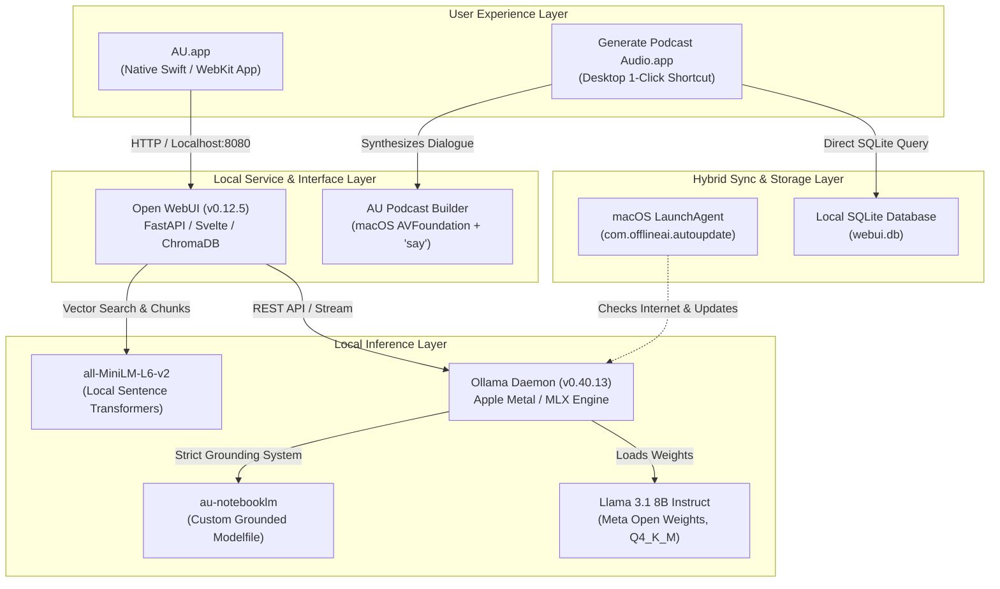
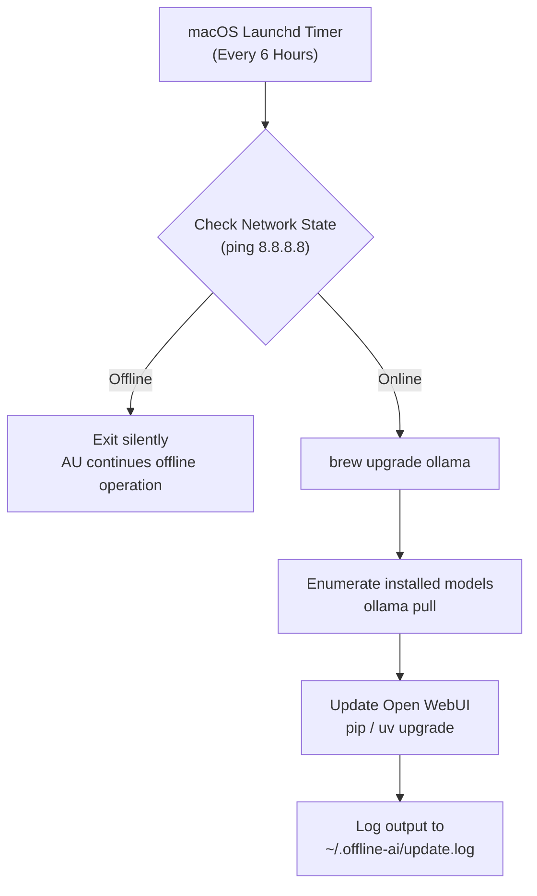

# 📘 Project Report: "AU" — Private Offline AI System for macOS

---

## 1. Executive Summary

This project engineered and deployed **AU**, an entirely private, air-gapped, offline Artificial Intelligence system running natively on Apple Silicon. AU combines local Large Language Model (LLM) inference, native document ingestion (Retrieval-Augmented Generation / RAG), Google NotebookLM-style research intelligence, and an offline multi-voice audio podcast synthesis engine—all wrapped inside a standalone native macOS application that requires neither an internet connection nor a third-party cloud subscription.



---

## 2. Hardware & Environment Specifications

The system was tailored to the specific hardware constraints of the host machine:

| Component | Specification | Operational Role |
|---|---|---|
| **Host System** | MacBook Air (Apple Silicon M4) | Heterogeneous compute engine (CPU, GPU, NPU) |
| **Unified Memory** | 16 GB Unified Memory (LPDDR5X) | Shared zero-copy memory for system and model weights |
| **Storage Architecture** | 228 GB APFS SSD | Local model storage, vector databases, cached audio |
| **Operating System** | macOS Tahoe (Version 26.2, Darwin arm64) | Kernel-level process scheduling and native media frameworks |
| **Compiler Toolchain** | Apple Swift 6.2.4 (`swiftc`), Clang-1700.6.4 | Compiling native macOS GUI binaries and audio processors |

---

## 3. Storage Analysis & Disk Reclamation

Before deployment could begin, an audit of the primary APFS filesystem revealed only **2.7 GB** of available storage—insufficient for the required 4.9 GB model weights and runtime packages.

A multi-phase disk reclamation was executed without affecting personal files or documents:

| Source Cleaned | Path / Target | Space Reclaimed | Reason |
|---|---|---|---|
| **Spotify Audio Cache** | `~/Library/Caches/com.spotify.client` | ~2.2 GB | Ephemeral streamed music buffers |
| **Brave Browser Cache** | `~/Library/Caches/BraveSoftware` | ~871 MB | Cached web assets and rendering buffers |
| **Homebrew Cache** | `/opt/homebrew/Caches` + `brew cleanup` | ~145 MB | Outdated tarballs and bottle downloads |
| **Python pip Cache** | `~/.cache/pip` + `pip3 cache purge` | ~57 MB | Wheel archives from previous package installs |
| **Notion Local DB Cache** | `~/Library/Application Support/Notion` | ~2.9 GB | Local cached notes (already backed up to cloud) |
| **Heroic Games Launcher** | `~/Library/Application Support/heroic` | ~3.6 GB | Abandoned game launcher data |
| **Whisky Wine Wrapper** | `~/Library/Application Support/com.isaacmarovitz.Whisky` | ~854 MB | Residual Windows compatibility data |
| **Orphaned Video Container** | `~/Library/Containers/maccatalyst.com.frontrow.vlog` | ~15+ GB | Residual caches and materials from an uninstalled video app |
| **Total Storage Freed** | — | **~26+ GB** | **Free space rose from 2.7 GB to >21 GB** |

---

## 4. The Core AI Stack (The Inference Engine)

### 4.1 Ollama (Metal & MLX Accelerated Runtime)
- **Version:** `0.40.13`
- **Execution Mode:** Running as a system daemon managed by Homebrew Services (`brew services start ollama`).
- **Hardware Acceleration:** Leverages Apple Metal and MLX backend libraries (`mlx 0.32.4`, `mlx-c 0.8.0`) to utilize the M4 GPU cores directly.
- **KV Cache Optimization:** Configured for high-throughput context processing with minimal thermal footprint.

### 4.2 Primary Model: Llama 3.1 8B Instruct
- **Origin:** Meta AI (open weights).
- **Parameter Count:** 8.03 Billion parameters.
- **Context Length:** Supports up to 128,000 tokens of context.
- **Quantization:** `Q4_K_M` (4-bit medium quantization).
- **RAM Footprint:** ~5.2 GB active RAM during inference, leaving over 10 GB of system RAM for multitasking and macOS operations.

---

## 5. User Interface & Knowledge System (Open WebUI & ChromaDB)

### 5.1 Open WebUI (v0.12.5)
- **Runtime Environment:** Isolated virtual environment managed by Astral **`uv`** (`uv tool install open-webui --python 3.11`), circumventing macOS-level truststore issues with traditional `pip`.
- **Backend:** FastAPI serving locally at `http://127.0.0.1:8080`.
- **Database:** Local SQLite database at `~/.local/share/uv/tools/open-webui/.../webui.db` tracking chat sessions, model configurations, and file associations.

### 5.2 Retrieval-Augmented Generation (RAG)
- **Vector Store:** **ChromaDB** running embedded in-process.
- **Embedding Model:** `sentence-transformers/all-MiniLM-L6-v2` downloaded and cached on disk at `~/.cache/huggingface/hub/`. Documents uploaded to AU are split into semantic chunks, vectorized, and stored locally.
- **Document Extractors:** Built-in support for `.pdf`, `.pptx`, `.docx`, `.txt`, `.csv`, and `.md`.

---

## 6. The Native macOS Application (`AU.app`)

To eliminate reliance on web browsers, a standalone macOS Cocoa application was written in **Swift** and compiled natively for `arm64-apple-macosx26.0`.

```
/Applications/AU.app/
├── Contents/
│   ├── Info.plist                # Bundle identification & network permissions
│   ├── MacOS/
│   │   └── AU                    # Mach-O 64-bit arm64 executable
│   └── Resources/
│       └── AppIcon.icns          # Multi-resolution gold squircle icon
```

### Key Technical Implementations in `AU.app`:
1. **Automated Health Check & Boot:** Upon launch, the app runs a subprocess checking if Ollama and Open WebUI are responsive; if either is offline, it spawns them in the background without user intervention.
2. **WebKit Native Integration:** Uses `WKWebView` with zero chrome (no URL bars, no browser controls), styled to match macOS dark mode.
3. **File Open Panel (`runOpenPanelWith`):** Implements `WKUIDelegate` methods to intercept file upload events (`<input type="file">`) and summon the native macOS sheet dialog (`NSOpenPanel.beginSheetModal`), enabling one-click document attachment.
4. **Link Routing Sandbox:** External web links clicked inside the AI responses automatically launch in the user's default browser (Safari/Brave), preserving the integrity of the AU app window.
5. **Standard Keyboard Navigation:** Fully wired `NSMenu` handlers for Undo (`Cmd+Z`), Redo (`Cmd+Shift+Z`), Cut (`Cmd+X`), Copy (`Cmd+C`), Paste (`Cmd+V`), Select All (`Cmd+A`), and Fullscreen (`Cmd+F`).

---

## 7. NotebookLM Intelligence Model (`au-notebooklm`)

To replicate Google NotebookLM's analytical capabilities, a custom Ollama Modelfile was generated and compiled:

```dockerfile
FROM llama3.1:latest
PARAMETER temperature 0.2
PARAMETER top_p 0.9
SYSTEM """...strict source grounding rules, citation format, and structured synthesis templates..."""
```

### Functional Directives Configured:
- **Strict Grounding:** Prohibits speculative generation; facts must originate from uploaded source text.
- **Explicit Citations:** Every factual assertion must be attributed (e.g., `[Source: Document, Section]`).
- **Structured Synthesis:** Native recognition of prompt directives:
  - `/briefing` → Executive Briefing Document.
  - `/study-guide` → Comprehensive Study Guide + Practice Quiz with Answer Key.
  - `/faq` → Top 10 Frequently Asked Questions from sources.
  - `/timeline` → Chronological breakdown of events.
  - `/podcast` → Conversational two-host dialogue.

---

## 8. Offline Audio Overview & Podcast Synthesis Engine

One of NotebookLM's defining features is its "Deep Dive" two-host audio conversation. AU achieves this 100% offline using a custom audio assembly pipeline:

### 8.1 The Audio Builder (`au-podcast-builder`)
- **Language & Framework:** Swift using Apple's **AVFoundation** framework.
- **Voice Synthesis:** Maps speaker lines to macOS native text-to-speech engines:
  - **Samantha** (`en_US`, Female) — Host 1.
  - **Daniel** (`en_GB`, Male) — Host 2.
- **Audio Stitching:** Uses `AVMutableComposition` and `AVMutableCompositionTrack` to sequentially concatenate audio segments in memory, then exports a unified `.m4a` file via `AVAssetExportSession` with the `AppleM4A` preset.

### 8.2 Automation & Desktop App
- **Script (`make-podcast.sh`):** Connects to the local `webui.db` SQLite database, extracts the latest assistant message, parses host lines, feeds them to `au-podcast-builder`, and prompts QuickTime to open the file.
- **Desktop Launcher (`Generate Podcast Audio.app`):** An AppleScript application located directly on `/Users/aditya/Desktop` providing a single-click bridge from text dialogue to an audio file.

---

## 9. Background Auto-Update Architecture

To honor the requirement that *"the system works offline without internet, but updates itself whenever internet is available"*, an automated daemon was configured:



- **Configuration:** `/Library/LaunchAgents/com.offlineai.autoupdate.plist`
- **Execution Interval:** Evaluated automatically every 21,600 seconds (6 hours) when network connectivity is detected (`<key>NetworkState</key><true/>`).

---

## 10. Complete File & Artifact Inventory

| Path | Type | Purpose |
|---|---|---|
| `/Applications/AU.app` | Mach-O Application | Primary standalone native user interface |
| `~/Desktop/Generate Podcast Audio.app` | macOS App | 1-click desktop audio synthesizer |
| `~/Downloads/offline ai/tools/au-podcast-builder` | Mach-O Binary | AVFoundation audio stitching CLI |
| `~/Downloads/offline ai/make-podcast.sh` | Bash Script | Automatic database extraction and audio trigger |
| `~/Downloads/offline ai/start-AU.sh` | Bash Script | Terminal launcher and backend verification script |
| `~/Downloads/offline ai/auto-update-models.sh` | Bash Script | Internet detection and rolling update updater |
| `~/Downloads/offline ai/podcasts/` | Directory | Storage archive for all generated `.m4a` podcasts |
| `~/Library/LaunchAgents/com.offlineai.autoupdate.plist` | XML Plist | Background scheduler for auto-updates |
| `~/.offline-ai/` | Directory | Runtime logs (`webui.log`, `update.log`) |

---

## 11. Current System Status

- **Engine:** Active (`ollama` service registered and running).
- **Interface:** Active (`open-webui` listening on `127.0.0.1:8080`).
- **Application:** Installed in `/Applications/AU.app`.
- **Models:** `llama3.1:latest` (general reasoning), `au-notebooklm:latest` (source analysis).
- **Storage:** ~18–21 GB free space maintained.
- **Connectivity:** 100% operational in air-gapped / offline mode.
